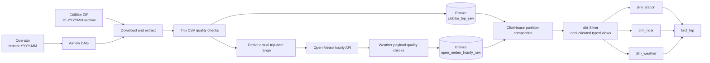
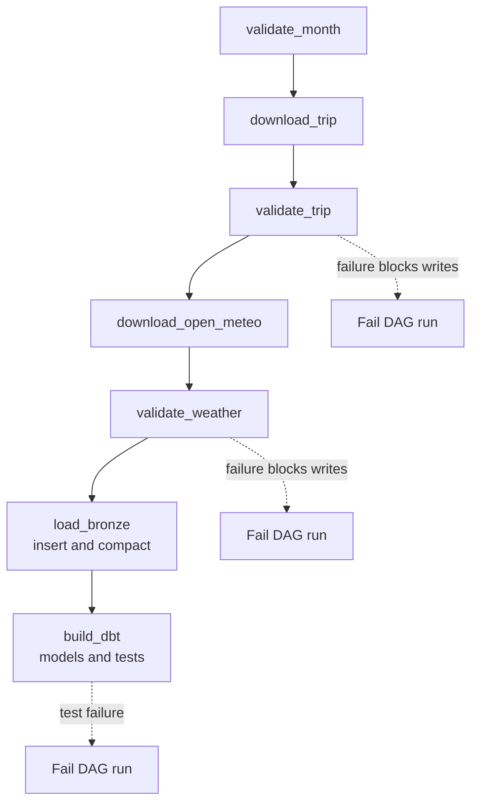
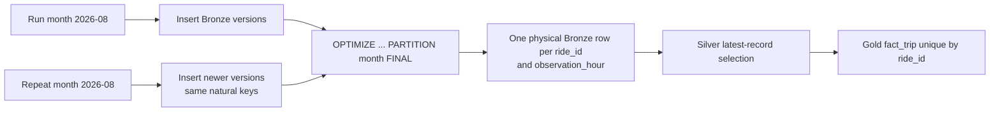

# Pipeline Architecture

## End-to-end data flow

## Airflow orchestration flow

## Idempotent rerun flow

Airflow writes deterministic local raw artifacts by month, validates each payload before any Bronze load, and invokes dbt only after both Bronze datasets load. ClickHouse persists raw records in `bronze`; dbt owns Silver views and Gold tables in `analytics`. The Compose environment creates a local `pipeline` ClickHouse user with no password; it is not a credential for any external service.

The fact table is partitioned by month and ordered by trip date/ride ID. Dimensions use stable hashes of their natural identifiers. A weather join is optional so valid trips survive an unavailable matching observation.

