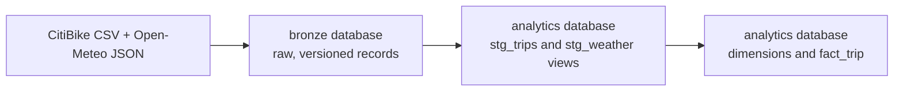

# ClickHouse Usage Guide

## Purpose

ClickHouse is the analytical warehouse for this project. It stores ingestion output in the Bronze layer and dbt-built Silver and Gold models. Airflow's PostgreSQL service is only Airflow metadata storage and is not the data-exploration database.

## Local connection

| Setting | Value |
| --- | --- |
| Host | `localhost` |
| HTTP port | `8123` |
| Native port | `9000` |
| User | `pipeline` |
| Password | None, for the local Docker environment only |
| JDBC URL | `jdbc:clickhouse://localhost:8123/analytics` |

Open the ClickHouse command-line client from the repository root:

```powershell
docker compose exec clickhouse clickhouse-client --user pipeline --database analytics
```

For a desktop SQL client, use the connection settings above. Leave the password empty. The local user is intentionally restricted to this Docker learning environment and must not be copied into a hosted deployment.

## Browser SQL UI

ClickHouse includes a built-in SQL editor at [http://localhost:8123/play](http://localhost:8123/play). It is the quickest way to explore the local warehouse without installing a desktop client.

Enter these connection values in the UI when prompted:

| Field | Value |
| --- | --- |
| Host | `localhost` |
| Port | `8123` |
| User | `pipeline` |
| Password | Leave empty |
| Database | `analytics` |

Use the SQL examples in the next section directly in the editor. The UI is available only while the local `clickhouse` Docker service is running.

## Data layers



| Layer | Location | Role |
| --- | --- | --- |
| Bronze | `bronze.citibike_trip_raw`, `bronze.open_meteo_hourly_raw` | Raw validated records plus source and ingestion metadata. |
| Silver | `analytics.stg_trips`, `analytics.stg_weather` | dbt views that retain the latest natural-key record, cast types, and remove invalid trips. |
| Gold | `analytics.dim_station`, `analytics.dim_weather`, `analytics.dim_rider`, `analytics.fact_trip` | Analytics-ready Star Schema. |

## Exploration queries

```sql
-- Discover objects
SHOW DATABASES;
SHOW TABLES FROM bronze;
SHOW TABLES FROM analytics;

-- Understand a table's physical design and columns
SHOW CREATE TABLE analytics.fact_trip;
DESCRIBE TABLE bronze.citibike_trip_raw;

-- Row counts by layer
SELECT count() AS bronze_trip_rows FROM bronze.citibike_trip_raw;
SELECT count() AS gold_trip_rows FROM analytics.fact_trip;

-- Gold sample with dimensions
SELECT
  fact.ride_id,
  fact.trip_date,
  fact.trip_duration_sec,
  start_station.station_name AS start_station,
  end_station.station_name AS end_station,
  rider.rideable_type,
  rider.member_casual,
  weather.temperature_2m
FROM analytics.fact_trip AS fact
JOIN analytics.dim_station AS start_station
  ON fact.start_station_key = start_station.station_key
JOIN analytics.dim_station AS end_station
  ON fact.end_station_key = end_station.station_key
JOIN analytics.dim_rider AS rider
  ON fact.rider_key = rider.rider_key
LEFT JOIN analytics.dim_weather AS weather
  ON fact.weather_key = weather.weather_key
ORDER BY fact.started_at
LIMIT 20;

-- Daily usage analysis
SELECT
  trip_date,
  count() AS trips,
  round(avg(trip_duration_sec), 0) AS average_duration_seconds
FROM analytics.fact_trip
GROUP BY trip_date
ORDER BY trip_date;
```

## Idempotency and maintenance

Bronze tables use `ReplacingMergeTree` with natural keys: `ride_id` for trips and `observation_hour` for weather. Every DAG run compacts its source-month partition after loading:

```sql
OPTIMIZE TABLE bronze.citibike_trip_raw PARTITION '2026-08' FINAL;
OPTIMIZE TABLE bronze.open_meteo_hourly_raw PARTITION '2026-08' FINAL;
```

This runs automatically in the DAG. Use it manually only when diagnosing interrupted historical loads. Do not drop databases or volumes during ordinary exploration: those actions erase pipeline state.

## Run transformations

Airflow runs dbt after Bronze loading. To rebuild and test manually:

```powershell
docker compose exec airflow-scheduler dbt build --project-dir /opt/airflow/dbt --profiles-dir /opt/airflow/dbt
```

This rebuilds Gold tables and runs source, schema, relationship, accepted-value, and duration-quality tests.

## Demo analyses

See [demo analytics queries](demo-analysis-queries.md) for runnable station, weekend, rider segment, precipitation, temperature, and e-bike analyses adapted to this project's implemented Gold schema.

